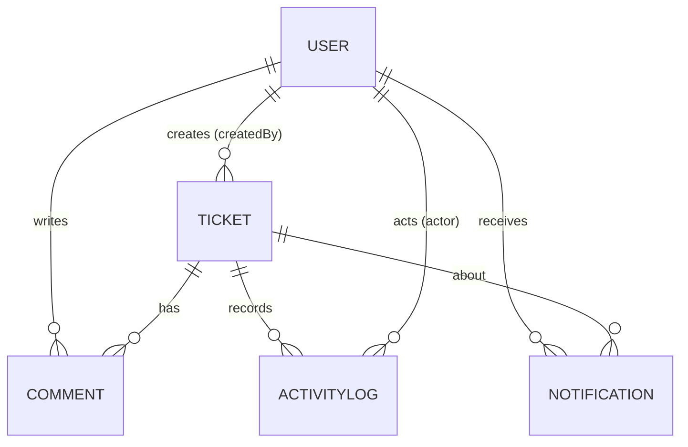

# Helpdesk - Support Ticket Management System

A full-stack mini helpdesk where **users raise support tickets** and **admins manage and resolve them**.
Built with Node.js, Express 5, MongoDB (Mongoose), React 19 (Vite), Tailwind CSS, shadcn/ui, Framer Motion and Lucide icons.

- **Live demo:** https://helpdesk-ticket-system-pied.vercel.app (see [Deployment](#deployment))_
- **API docs:** [`postman/Helpdesk.postman_collection.json`](postman/Helpdesk.postman_collection.json) + the [endpoint table](#api-reference) below
- **Demo accounts** (after `npm run seed`):

| Role  | Email                | Password    |
|-------|----------------------|-------------|
| Admin | `admin@helpdesk.dev` | `Admin@123` |
| User  | `user@helpdesk.dev`  | `User@1234` |

---

## Features

**Authentication & authorization**
- Register / login with **JWT** (Bearer token), passwords hashed with bcrypt (cost 12)
- Two roles: `user` and `admin`, enforced by middleware on every route
- Role cannot be self-assigned; admins are created via seed script or an optional `ADMIN_SIGNUP_CODE`

**Tickets** (title, description, category, priority, status, owner, timestamps)
- Users: create, view *only their own*, edit & delete (while `open`), track status, comment
- Admins: view all, filter by status / priority / category, update status & priority, delete, reply to any ticket
- Search, sorting (newest / oldest / priority / recently updated) and pagination

**Comments** - tied to a ticket and an author; staff replies are badged; closed tickets lock user comments.

**Event-driven workflow** - `ticket.created`, `ticket.updated`, `ticket.status_changed`, `ticket.comment_added`, `ticket.resolved` each trigger an **activity log entry** and **in-app notifications** (see [Events](#event-driven-workflow)).

**Bonus implemented:** search & pagination, sorting & filtering, dashboard with statistics, notifications (bell with unread count), React frontend, Docker support, automated tests, Postman collection.

**Frontend:** shadcn/ui components (Radix primitives + Tailwind), Framer Motion animations (page transitions, staggered lists, animated counters/bars, animated comments), Lucide icons, light/dark theme, fully responsive.

---

## Quick start

**Prerequisites:** Node 20+, MongoDB running locally (or an Atlas URI).

```bash
# 1. Backend
cd backend
cp .env.example .env        # edit MONGODB_URI / JWT_SECRET if needed
npm install
npm run seed                # optional: demo admin, user and tickets
npm run dev                 # http://localhost:5000

# 2. Frontend (new terminal)
cd frontend
npm install
npm run dev                 # http://localhost:5173  (proxies /api to :5000)
```

**Or with Docker** (MongoDB + API + frontend, no local installs):

```bash
docker compose up --build
# App: http://localhost:8080
docker compose exec backend node src/scripts/seed.js   # optional demo data
```

### Environment variables (`backend/.env`)

| Variable            | Description                                              | Default                              |
|---------------------|----------------------------------------------------------|--------------------------------------|
| `PORT`              | API port                                                 | `5000`                               |
| `MONGODB_URI`       | MongoDB connection string                                | `mongodb://127.0.0.1:27017/helpdesk` |
| `JWT_SECRET`        | Token signing secret (**required in production**)        | dev-only fallback                    |
| `JWT_EXPIRES_IN`    | Token lifetime                                           | `7d`                                 |
| `CLIENT_URL`        | Allowed CORS origin(s), comma separated                  | `http://localhost:5173`              |
| `ADMIN_SIGNUP_CODE` | If set, registering with this code creates an admin      | _(disabled)_                         |

Frontend: `VITE_API_URL` (only needed when the API is on a different origin, e.g. `https://api.example.com/api`).

---

## Architecture

```
backend/src
├── config/        env, db connection, constants (roles, statuses, events)
├── models/        User, Ticket, Comment, ActivityLog, Notification (Mongoose)
├── validators/    zod schemas for every request body / query / param
├── middleware/    authenticate + authorize (RBAC), validate, error handling
├── controllers/   request handlers (auth, tickets, comments, admin, stats, notifications)
├── routes/        route table - the single place that wires URL → middleware → controller
├── events/        eventBus + handlers (activity log, notifications)
└── scripts/       seed
frontend/src
├── components/    ui/ (shadcn primitives) + app components
├── pages/         Auth, Dashboard, Tickets, TicketDetail
├── context/       AuthContext (session)       lib/  api client, utils, theme
```

**Separation of responsibilities:** routes declare *what* is allowed (auth, role, validation) → controllers hold request logic → models own persistence and invariants → event handlers own side effects. Controllers never write activity logs or notifications directly.

### Event-driven workflow

Controllers publish a domain event after a successful state change:

```js
await eventBus.publish(EVENTS.STATUS_CHANGED, { ticket, actor, meta: { from, to } });
```

Handlers subscribed in `events/handlers.js` react independently:

| Event                   | Published when                          | Activity log | Notification goes to                               |
|-------------------------|------------------------------------------|:------------:|----------------------------------------------------|
| `ticket.created`        | User submits a ticket                    | ✔            | All admins                                         |
| `ticket.updated`        | Owner edits, or admin changes priority   | ✔            | Admins (if owner acted) / owner (if admin acted)   |
| `ticket.status_changed` | Admin changes status                     | ✔            | Ticket owner (skipped when resolved - see below)   |
| `ticket.comment_added`  | Anyone comments                          | ✔            | The other party (admins ↔ owner)                   |
| `ticket.resolved`       | Admin sets status to `resolved`          | ✔            | Ticket owner ("marked as resolved")                |

Design notes: the actor is never notified of their own action; resolving fires *both* `status_changed` and `resolved` (full audit trail) but the owner receives a single notification. `publish()` uses `Promise.allSettled`, so a failing handler is logged and **never breaks the user's request**. The bus is an in-process `EventEmitter`; swapping it for Redis/BullMQ later only touches `eventBus.js`.

---

## Database design

MongoDB with five collections. Relationships are by `ObjectId` reference; lists that are queried independently (comments, activity) live in their own collections instead of unbounded embedded arrays.



| Collection        | Key fields                                                                                                              | Indexes                                        |
|-------------------|--------------------------------------------------------------------------------------------------------------------------|------------------------------------------------|
| **users**         | `name`, `email` (unique, lowercase), `password` (bcrypt, `select:false`), `role` (`user`/`admin`)                        | `email` unique, `role`                         |
| **tickets**       | `title`, `description`, `category`, `priority`, `priorityRank`, `status`, `createdBy`→User, `commentCount`, `resolvedAt` | `{createdBy,createdAt}`, `{status,priorityRank,createdAt}`, `{category}` |
| **comments**      | `ticket`→Ticket, `author`→User, `authorRole` (snapshot), `body`                                                          | `{ticket,createdAt}`                           |
| **activitylogs**  | `ticket`→Ticket, `actor`→User, `actorRole`, `type` (event name), `meta` (e.g. `{from,to}`), `createdAt`                  | `ticket`, `{createdAt:-1}`                     |
| **notifications** | `user`→User, `ticket`→Ticket, `type`, `message`, `read`, `createdAt`                                                     | `{user,read,createdAt:-1}`                     |

Why these choices
- **`priorityRank`** is a numeric mirror of `priority` so "sort by priority" is correct (alphabetical order would put `urgent` before `low`... wrongly). It is set by a `pre('validate')` hook.
- **`commentCount`** is denormalised onto the ticket so list views don't need a join/aggregation per row.
- **`authorRole`** is snapshotted on each comment so staff replies stay badged even if roles change later.
- **Cascade:** deleting a ticket removes its comments, activity and notifications.
- Compound indexes match the real query shapes: "my tickets newest first", and admin "status + priority" filtering.

---

## API reference

Base URL: `/api`. All bodies are JSON. Protected routes need `Authorization: Bearer <token>`.
Errors share one shape: `{ "success": false, "message": "...", "errors": [{ "field", "message" }] }`.

| Method | Path                          | Access        | Description                                                       |
|--------|-------------------------------|---------------|-------------------------------------------------------------------|
| POST   | `/auth/register`              | public        | Create account → `{ user, token }`                                |
| POST   | `/auth/login`                 | public        | Login → `{ user, token }`                                         |
| GET    | `/auth/me`                    | any           | Current user                                                      |
| GET    | `/tickets`                    | any           | List (users: own, admins: all). Query: `status, priority, category, search, sort, page, limit` |
| POST   | `/tickets`                    | any           | Create ticket                                                     |
| GET    | `/tickets/:id`                | owner / admin | Ticket details                                                    |
| PATCH  | `/tickets/:id`                | owner         | Edit title/description/category/priority (only while `open`)      |
| DELETE | `/tickets/:id`                | owner / admin | Delete (owner only while `open`; admin any)                       |
| GET    | `/tickets/:id/comments`       | owner / admin | List comments                                                     |
| POST   | `/tickets/:id/comments`       | owner / admin | Add comment (users blocked on `closed` tickets)                   |
| GET    | `/tickets/:id/activity`       | owner / admin | Event-driven activity log                                         |
| PATCH  | `/admin/tickets/:id`          | **admin**     | Change `status` and/or `priority`                                 |
| GET    | `/admin/activity`             | **admin**     | Recent activity across all tickets                                |
| GET    | `/stats`                      | any           | Ticket statistics (scoped: users → own, admins → all)             |
| GET    | `/notifications`              | any           | Own notifications + `unreadCount`                                 |
| PATCH  | `/notifications/:id/read`     | any (own)     | Mark one as read                                                  |
| POST   | `/notifications/read-all`     | any           | Mark all as read                                                  |
| GET    | `/health`                     | public        | Liveness check                                                    |

Status codes used: `200/201` success, `400` malformed input, `401` unauthenticated, `403` forbidden role, `404` not found *or not yours*, `409` conflict (duplicate email, edit a non-open ticket), `422` validation failed.

---

## Security & data protection

- **JWT** with expiry; the user is re-loaded from the DB on every request, so deleted accounts and role changes take effect immediately.
- **Passwords:** bcrypt (cost 12), never returned (`select:false` + `toJSON` strip). Login uses a generic error and a dummy-hash comparison so unknown emails aren't distinguishable by message or timing.
- **Authorization:** role checks via `authorize('admin')`; ownership checks in a single `loadAccessibleTicket` helper. Other users' tickets return **404 (not 403)** so ids can't be probed.
- **Mass-assignment protection:** zod strips unknown body keys (e.g. a `role` field on register is ignored).
- **NoSQL-injection hardening:** every query param is validated against enums/numbers; operator objects like `status[$ne]=x` are rejected. Search input is regex-escaped.
- `helmet` headers, CORS allow-list, 100 KB body limit, rate limiting on `/auth/*`, no stack traces or internals in production errors.

---

## Testing

```bash
cd backend
npm test                       # all tests
npx vitest run tests/smoke.test.js          # DB-free: wiring, validation, auth guards, event bus
```

- `tests/smoke.test.js` - runs anywhere (no database): routing, validation, token checks (including a forged token), malformed JSON, event-bus isolation and handler registration.
- `tests/helpdesk.test.js` - end-to-end API tests (19 cases) covering auth, RBAC, ownership isolation, the full ticket lifecycle, comments, events/notifications, filters/sort/pagination, stats, and cascade delete. It uses `mongodb-memory-server` by default; to run against an existing MongoDB set `MONGO_TEST_URI=mongodb://127.0.0.1:27017/helpdesk_test` (the database is **dropped** first).

---

## Deployment

A typical free-tier setup:

1. **Database:** create a free MongoDB Atlas cluster, allow network access, copy the connection string.
2. **API (Render / Railway / Fly):** root directory `backend`, build `npm install`, start `npm start`. Set `MONGODB_URI`, `JWT_SECRET` (long random string), `CLIENT_URL` (your frontend URL), `NODE_ENV=production`. Run `npm run seed` once from the service shell if you want demo data.
3. **Frontend (Vercel / Netlify):** root directory `frontend`, build `npm run build`, output `dist`. Set `VITE_API_URL=https://<your-api-host>/api`. `vercel.json` already contains the SPA rewrite.
4. Paste the frontend URL at the top of this README.

The Docker setup (`docker compose up --build`) also works on any VPS; nginx serves the SPA and proxies `/api` to the backend.

---

## Implementation decisions & trade-offs

- **Express 5** forwards async errors natively, so controllers have no try/catch boilerplate.
- **In-process event bus** keeps the assignment dependency-free while still demonstrating decoupling; the handler contract is the same one a queue would use.
- **Polling (20s) for notifications** instead of WebSockets: simple, stateless, works behind any host. Real-time push would be a natural next step.
- **Edit/delete only while `open`:** once an admin is working on a ticket the requester can no longer rewrite history; comments remain the channel for new information.
- **Admins manage, not rewrite:** admins change status/priority and reply, but can't edit the requester's text.
- **Token in `localStorage`:** simplest for a SPA + separate API; an httpOnly-cookie flow with CSRF protection would be the hardening step for a production system.
- **Email notifications** are not implemented; the notifier is the single place to add them.

## Possible improvements
Email/WebSocket notifications, ticket assignment to specific agents, file attachments, SLA timers, refresh tokens, and CI running the test suite.
